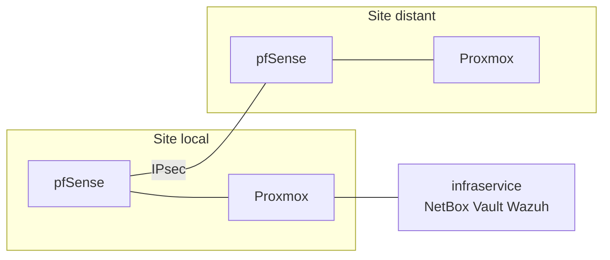

# T-NSA-810 — CIA

Infrastructure **hybride de laboratoire** : deux sites Proxmox reliés par IPsec, pare-feu pfSense, IPAM NetBox, secrets Vault, supervision Wazuh.

Projet Cloud Infrastructure Architects (Epitech). Le dépôt décrit une infrastructure reproductible, pas un environnement de production exposé sur Internet.

<p align="center">
  
  
  
  
  
  
</p>

<p align="center">
  <strong>Dépôt :</strong> <a href="https://github.com/Meriem1403/T-NSA-810---CIA">github.com/Meriem1403/T-NSA-810---CIA</a>
  &nbsp;·&nbsp;
  <strong>Suivi :</strong> <a href="./docs/trophees-validation.md">trophées</a>
  · <a href="./docs/status-2026-06-23.md">état au 23 juin 2026</a>
</p>

---

## Sommaire

- [Présentation](#présentation)
- [Ce que le labo couvre](#ce-que-le-labo-couvre)
- [Pile technique](#pile-technique)
- [Architecture](#architecture)
- [Prérequis](#prérequis)
- [Prise en main](#prise-en-main)
- [Sécurité](#sécurité)
- [Structure du projet](#structure-du-projet)
- [Documentation](#documentation)
- [Contribution](#contribution)

---

## Présentation

Deux sites Proxmox (local et distant) sont reliés par un VPN IPsec. Chaque site a un pare-feu pfSense. L'adressage est tenu dans NetBox, les secrets dans Vault, les journaux dans Wazuh. Un annuaire Active Directory (`mar2.local`), un bastion et Guacamole encadrent l'administration. Un site web interne n'est joignable que depuis le labo.

L'ancien squelette Kubernetes (Flux) est archivé dans `legacy/flux-bootstrap/`. Les notes Elastic/Filebeat et OpenVPN correspondent à une phase initiale : la supervision courante est Wazuh.

Le détail d'avancement est dans [`docs/status-2026-06-23.md`](./docs/status-2026-06-23.md) et [`docs/gantt.md`](./docs/gantt.md).

---

## Ce que le labo couvre

| Exigence | Où c'est traité |
|----------|-----------------|
| Un site local et un site distant Proxmox | `docs/architecture.md`, `iac/terraform/` |
| VPN site à site (IPsec) et client à site | `docs/architecture.md`, `docs/demo-scenarios.md` |
| Pare-feu des deux côtés | `configs/pfsense/`, `docs/drp-runbook.md` |
| Bastion | `docs/architecture.md`, Guacamole |
| IPAM NetBox mis à jour | `configs/netbox/`, `iac/ansible/` |
| Journaux et supervision | Wazuh, `configs/wazuh/` |
| Site interne uniquement | `apps/internal-site/` |
| DNS entre les sites | domaine `mar2.local`, `configs/dns/` |
| Secrets | Vault, `docs/secrets-and-access.md` |
| Infrastructure décrite en code | `iac/` |

Contrainte du sujet : au plus trois machines virtuelles par site. Les services partagés sont regroupés sur l'hôte `infraservice`.

---

## Pile technique

| Couche | Technologie | État suivi |
|--------|-------------|------------|
| Virtualisation | Proxmox VE, deux nœuds | En place |
| Réseau | pfSense, CARP, IPsec, bastion SSH | En place |
| Identité | Active Directory `mar2.local`, Guacamole | LDAPS encore à finaliser |
| IPAM | NetBox (Docker, API, Ansible) | En place |
| Secrets | HashiCorp Vault, Raft, KV v2, AppRole | En place |
| Supervision | Wazuh et agents | Tableaux de bord à finaliser |
| Données | PostgreSQL, Valkey | En place |
| IaC | Ansible, Terraform (provider Proxmox) | `terraform apply` dépend du template |
| Proxy | Nginx, HTTPS via la PKI de l'annuaire | À finaliser |

Les statuts détaillés restent ceux du document d'état, pas une promesse de production.

---

## Architecture



Les adresses précises du labo sont dans [`docs/architecture.md`](./docs/architecture.md). Elles ne sortent pas du réseau du projet.

---

## Prérequis

- Accès au labo Proxmox et aux pare-feu
- **Ansible** et **Terraform**
- **Git**
- Un coffre pour les secrets (Vault ou `ansible-vault`), jamais le dépôt

---

## Prise en main

```bash
git clone https://github.com/Meriem1403/T-NSA-810---CIA.git
cd T-NSA-810---CIA
```

1. Lire [`docs/architecture.md`](./docs/architecture.md) et le diagramme [`docs/architecture-diagram.png`](./docs/architecture-diagram.png).
2. Préparer l'inventaire Ansible à partir de l'exemple, sans committer l'inventaire réel :

```bash
cd iac/ansible
cp inventory/example.inventory.yml inventory/production.yml
ansible-playbook -i inventory/production.yml playbooks/site.yml --check
```

3. Côté Terraform, valider le plan sans appliquer tant que le template Cloud-Init n'est pas sur Proxmox :

```bash
cd iac/terraform
terraform init
terraform validate
terraform plan
```

Le déroulé complet est [`docs/deploy-lab.md`](./docs/deploy-lab.md). La reprise après incident est [`docs/drp-runbook.md`](./docs/drp-runbook.md).

---

## Sécurité

- Aucun secret, état Terraform, profil VPN ou clé de déverrouillage Vault dans Git.
- Matrice d'accès : [`docs/secrets-and-access.md`](./docs/secrets-and-access.md).
- Le site interne n'est pas publié sur Internet.
- Les playbooks se testent d'abord avec `--check`.

---

## Structure du projet

```
T-NSA-810---CIA/
├── docs/                  # Architecture, état, soutenance, runbooks
├── iac/ansible/           # Playbooks et rôles
├── iac/terraform/         # Machines Proxmox
├── iac/docker/            # Compose NetBox
├── configs/               # pfSense, DNS, NetBox, Wazuh
├── apps/internal-site/    # Site joignable seulement dans le labo
├── scripts/
└── legacy/flux-bootstrap/ # Ancien essai Kubernetes
```

---

## Documentation

| Document | Contenu |
|----------|---------|
| [docs/architecture.md](./docs/architecture.md) | Schéma, VLAN, VPN, services |
| [docs/deploy-lab.md](./docs/deploy-lab.md) | Déploiement du labo |
| [docs/drp-runbook.md](./docs/drp-runbook.md) | Reprise après incident |
| [docs/secrets-and-access.md](./docs/secrets-and-access.md) | Coffre et accès |
| [docs/demo-scenarios.md](./docs/demo-scenarios.md) | Scénarios de démonstration |
| [docs/git-workflow.md](./docs/git-workflow.md) | Branches et messages |
| [docs/trophees-validation.md](./docs/trophees-validation.md) | Grille des trophées |
| [docs/checklist-evaluation.md](./docs/checklist-evaluation.md) | Critères et livrables |
| [docs/gantt.md](./docs/gantt.md) | Planning |

---

## Contribution

Branches `feature/<sujet>` et `fix/<sujet>`. Messages à l'impératif, par exemple `docs(architecture): précise le VPN`. Ne pas pousser de secret. Le détail est dans [`docs/git-workflow.md`](./docs/git-workflow.md).

Équipe du labo : les commits gardent leurs auteurs.

---

<p align="center">
  <sub>CIA — labo Proxmox, pfSense, Vault et Wazuh. Aucun secret dans le dépôt.</sub>
</p>
