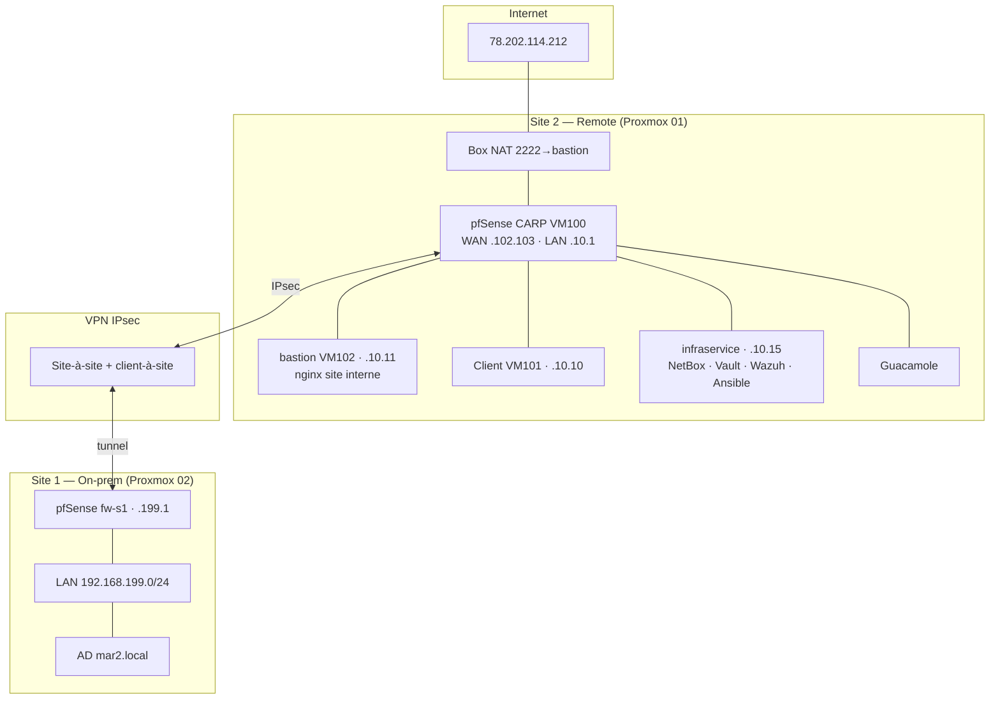

# Architecture — Hybrid Cloud CIA (deux sites Proxmox)

Document de référence pour la soutenance. Dernière harmonisation : **23 juin 2026**.

- Diagramme PNG : [`architecture-diagram.png`](./architecture-diagram.png)
- Source Mermaid : [`architecture-diagram.mmd`](./architecture-diagram.mmd)
- État d’avancement détaillé : [`status-2026-06-23.md`](./status-2026-06-23.md)

## Vue d’ensemble

| Site | Hyperviseur | Rôle | État labo |
|------|-------------|------|-----------|
| **S1 — On‑prem** | Proxmox 02 | Site principal, AD, pfSense, routage VPN | ✅ Opérationnel |
| **S2 — Remote** | Proxmox 01 (`Proxmox-01`) | Site distant Internet, pfSense CARP, bastion, InfraService | ✅ Opérationnel |

**Domaine interne :** `mar2.local`

**Avancement global estimé :** 90 % (voir [`gantt.md`](./gantt.md)).

---

## Plateforme InfraService (services centralisés)

Hôte : **`infraservice`** — `192.168.10.15` (LAN site 2, `192.168.10.0/24`)

| Service | Rôle | URL / port | État |
|---------|------|------------|------|
| NetBox | IPAM / DCIM | `http://192.168.10.15:8000` | ✅ |
| PostgreSQL | Base NetBox | localhost (Docker) | ✅ |
| Valkey (Redis) | Cache NetBox | localhost (Docker) | ✅ |
| HashiCorp Vault | Secrets (Raft, KV v2, AppRole) | `http://192.168.10.15:8200` | ✅ |
| Ansible | Automatisation (lecture Vault validée) | exécution locale | ✅ |
| Terraform | Provisionnement Proxmox | exécution locale | 🟡 `apply` en attente de template |
| Wazuh (manager) | Supervision / SIEM | `wazuh.mar2.local` | 🟡 Finalisation dashboards |
| Nginx (futur) | Reverse proxy HTTPS | `netbox.mar2.local`, `vault.mar2.local`… | 🟡 À finaliser |
| API Kill Switch (futur) | `api.mar2.local` | — | 🟡 En développement |

> **Note :** les services sont regroupés sur `infraservice` pour respecter la contrainte **3 VMs max / site Proxmox**. Le modèle documentaire site 1 (`svc-s1` sur `192.168.199.20`) reste la cible hybride cible ; le labo actuel concentre l’IPAM et les secrets sur S2.

---

## Site 2 — Remote (détail opérationnel)

| VM ID | Nom | Rôle | IP |
|-------|-----|------|-----|
| 100 | FW | pfSense (CARP) | WAN `192.168.102.103` · LAN `192.168.10.1/24` |
| 101 | Client | Windows (poste interne) | `192.168.10.10` |
| 102 | bastion-s2 | Ubuntu, nginx (site interne), SSH | `192.168.10.11` |
| — | infraservice | NetBox, Vault, Wazuh, Ansible, Terraform… | `192.168.10.15` |

**Accès opérateur**

| Usage | Adresse |
|-------|---------|
| IP publique box | `78.202.114.212` |
| VPN IPsec (site-à-site / client) | Via pfSense (IKEv2/IPsec) |
| SSH bastion (NAT box) | `ssh -p 2222 bastion@78.202.114.212` |
| Proxmox S2 (VPN requis) | `https://192.168.102.11:8006` |
| NetBox | `http://192.168.10.15:8000` |
| Vault | `http://192.168.10.15:8200` |
| Guacamole | LAN / VPN (accès bastion graphique) |
| GUI pfSense | `https://192.168.10.1` |

**Segmentation S2**

- **WAN** : `192.168.102.0/24` (uplink box / Internet)
- **LAN** : `192.168.10.0/24` — clients, bastion, InfraService
- **VPN IPsec** : tunnels site-à-site et client-à-site (paramètres dans pfSense, secrets hors Git)

---

## Site 1 — On‑prem

| Composant | Nom | Rôle | IP |
|-----------|-----|------|-----|
| Hyperviseur | Proxmox 02 | Virtualisation | selon plan d’adressage S1 |
| Pare-feu | fw-s1 | pfSense | `192.168.199.1` (LAN) |
| Identité | AD `mar2.local` | DNS, LDAP (LDAPS à finaliser) | 🟡 |
| Services (cible) | svc-s1 | Modèle hybride NetBox/obs. | `192.168.199.20` |

Routage VPN observé (client distant) : trafic inter-sites via tunnel IPsec entre pfSense S1 ↔ S2.

---

## Schéma logique

---

## Pare-feu (S2 — résumé)

Voir [`../configs/pfsense/site2-wan-rules.md`](../configs/pfsense/site2-wan-rules.md).

| Flux | Port / proto | Action | Justification |
|------|--------------|--------|---------------|
| Internet → WAN | IPsec (UDP 500/4500, ESP) | Autoriser | VPN site-à-site et client |
| Internet → WAN | TCP 22 | Refuser | SSH non exposé sur 22 public |
| Box → WAN | TCP 2222 → bastion:22 | Autoriser | Accès bastion administré |
| Internet → WAN | TCP 80/443 (direct LAN) | Refuser | Pas d’exposition web directe |
| VPN → LAN S2 | RFC1918 S2 | Autoriser | Administration post-tunnel |
| LAN → Internet | Étatful | Autoriser | Sortie utilisateurs |

---

## DNS (`mar2.local`)

| Type | Nom | Cible |
|------|-----|-------|
| Host override | `client1.site2.local` | `192.168.10.10` |
| Service | `netbox.mar2.local` | `192.168.10.15` (futur HTTPS via Nginx) |
| Service | `vault.mar2.local` | `192.168.10.15` |
| Service | `wazuh.mar2.local` | manager Wazuh |
| Domaine | `mar2.local` | DNS Active Directory + forwarders pfSense |

Test : `nslookup client1.site2.local 192.168.10.1` depuis le bastion.

---

## Bastion et accès distant

- **SSH bastion** : compte `bastion`, accès via NAT port **2222** ou VPN.
- **Guacamole** : accès graphique/SSH centralisé (durcissement SSO en cours).
- Pas de connexion root directe depuis Internet.
- Saut vers VM interne : `ssh -J bastion@78.202.114.212:2222 user@192.168.10.10`.

---

## Site web interne

- Service : **nginx** sur `192.168.10.11` (VM bastion).
- Contenu versionné : [`../apps/internal-site/`](../apps/internal-site/).
- Accessible depuis LAN S2 et VPN ; **non** joignable en HTTP direct sur IP publique.

---

## IPAM NetBox

- Instance : `http://192.168.10.15:8000`
- Données modèle : [`../configs/netbox/sites-prefixes.example.yml`](../configs/netbox/sites-prefixes.example.yml)
- Sync API : [`../configs/netbox/scripts/sync_from_inventory.py`](../configs/netbox/scripts/sync_from_inventory.py) + playbook `netbox-sync.yml`
- Prochaine étape : compléter sites, VLAN, préfixes, équipements et VMs dans NetBox.

---

## Observabilité (Wazuh)

- **Manager Wazuh** sur `infraservice` (remplace la stack ELK initiale).
- **Agents** déployés sur les hôtes supervisés.
- Dashboards et alertes : à finaliser pour la soutenance.
- Legacy ELK/Filebeat : playbooks `deploy-observability.yml`, [`../configs/elastic/`](../configs/elastic/) (phase initiale, conservés à titre d’archive).

---

## Gestion des secrets (Vault)

- Stockage Raft intégré, moteur KV v2 sur `infra/`.
- Policies et **AppRole** dédié à Ansible (`community.hashi_vault`).
- Snapshots Raft automatisés.
- Aucun secret dans Git — voir [`secrets-and-access.md`](./secrets-and-access.md).

---

## IaC

| Outil | État | Détail |
|-------|------|--------|
| Ansible | ✅ | Inventaire, playbooks, intégration Vault AppRole |
| Terraform | 🟡 | Provider `telmate/proxmox` validé ; `apply` bloqué par absence du template `ubuntu-template` |

Chaîne cible : **Terraform** (création VM) → **Ansible** (configuration post-déploiement).

---

## Kill switch et DRP

- Script d’aide : [`../scripts/kill-switch-s2.sh`](../scripts/kill-switch-s2.sh)
- Procédures : [`drp-runbook.md`](./drp-runbook.md)
- Actions prévues : blocage IP, isolement VM, coupure VPN/VLAN, liaison Wazuh → Kill Switch API.

---

## Évolutivité

Convention d’adressage pour un **site N** :

- LAN site N : `192.168.(10+N).0/24`
- pfSense LAN : `.1`
- Bastion : `.11`
- InfraService / services : `.15`
- Premier client : `.10`

Documenter chaque nouveau site dans NetBox avant déploiement playbook.

---

## Historique / legacy

| Élément | Statut |
|---------|--------|
| OpenVPN UDP 1194 (`configs/openvpn/`) | Phase initiale — remplacé par IPsec |
| Elastic/Kibana sur VM 103 (`192.168.10.12`) | Remplacé par Wazuh + NetBox sur `infraservice` |
| Playbooks `iac/docker/elastic/` | Conservés ; non utilisés en production labo actuelle |
| Flux/Kubernetes (`legacy/flux-bootstrap/`) | Archive bonus GitOps |
