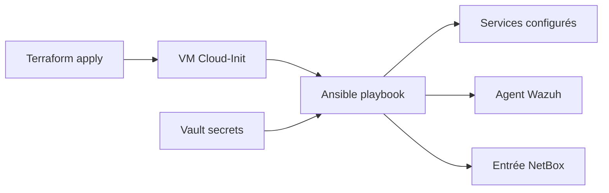

# Guide Infrastructure as Code — CIA

Documents pour les trophées `iac_delivery` et `iac_quality`.

## Vue d'ensemble

| Outil | Rôle | Chemin | État |
|-------|------|--------|------|
| Ansible | Configuration (CM) | `iac/ansible/` | ✅ Opérationnel |
| Terraform | Provisionnement VMs | `iac/terraform/` | 🟡 plan OK, apply en attente |
| Docker Compose | Services conteneurisés | `iac/docker/` | ✅ NetBox déployé |

## Livraison IaC (`iac_delivery`)

### Ansible — contenu versionné

```text
iac/ansible/
├── ansible.cfg
├── inventory/example.inventory.yml
├── group_vars/
├── playbooks/
│   ├── site.yml                 # Baseline + bastion
│   ├── deploy-site1.yml         # NetBox + Elastic (legacy)
│   ├── deploy-observability.yml # Filebeat (legacy)
│   └── netbox-sync.yml          # Sync IPAM API
└── roles/
    ├── common, bastion, docker_host
    ├── netbox_stack, elastic_stack, filebeat
    └── netbox_sync
```

### Terraform — contenu versionné

```text
iac/terraform/
├── versions.tf          # Provider telmate/proxmox épinglé
├── variables.tf         # Variables typées
├── main.tf              # Ressource proxmox_vm_qemu
├── outputs.tf           # IP VM créée
└── terraform.tfvars.example
```

### Commandes de preuve

```bash
# Ansible — syntaxe
cd iac/ansible
ansible-playbook playbooks/site.yml --syntax-check
ansible-playbook playbooks/netbox-sync.yml --syntax-check

# Ansible — exécution (avec inventaire production)
ansible-playbook -i inventory/production.yml playbooks/site.yml --check

# Terraform
cd iac/terraform
terraform init
terraform validate
terraform plan -var-file=terraform.tfvars
```

## Qualité IaC (`iac_quality`)

### Bonnes pratiques Ansible

| Pratique | Implémentation |
|----------|----------------|
| Idempotence | Modules `ansible.builtin.*`, handlers |
| Modularité | Rôles séparés par fonction |
| Tags | `tags: [bastion, netbox, docker]` |
| Secrets | `vault_*` variables, Vault AppRole, jamais en clair |
| Inventaire | `example.inventory.yml` versionné, `production.yml` gitignored |
| Documentation | `iac/ansible/README.md` |

### Bonnes pratiques Terraform

| Pratique | Implémentation |
|----------|----------------|
| Provider épinglé | `versions.tf` avec `required_providers` |
| Variables typées | `variables.tf` avec descriptions |
| Exemple config | `terraform.tfvars.example` (sans secrets) |
| État distant | `.tfstate` dans `.gitignore` |
| Validation | `terraform fmt`, `validate`, `plan` avant apply |
| Chaîne | Terraform → Ansible post-deploy |

### Intégration Vault ↔ Ansible

```yaml
# Pattern recommandé (group_vars ou playbook)
# Secret lu depuis Vault KV infra/ via AppRole
netbox_token: "{{ lookup('community.hashi_vault', 'infra/data/netbox', ...) }}"
```

- Collection : `community.hashi_vault`
- Auth : AppRole (role_id versionnable, secret_id hors Git)

### Critères qualité vérifiables

| Critère | Preuve |
|---------|--------|
| Pas de secrets dans Git | `git log -p` + `.gitignore` |
| Playbooks rejouables | 2ᵉ exécution = `changed=0` |
| Terraform plan déterministe | Même plan sans drift |
| README par module | `iac/ansible/README.md`, `iac/terraform/README.md` |
| Inventaire structuré | Groupes `site1`, `site2`, `site2_bastion`, `site2_services` |

## Chaîne de déploiement cible



1. `terraform apply` — crée VM Ubuntu depuis template Cloud-Init
2. `ansible-playbook site.yml` — baseline (packages, SSH, nginx)
3. `ansible-playbook deploy-site1.yml` — services Docker (si applicable)
4. Agent Wazuh — enrôlement automatique
5. `netbox-sync.yml` — mise à jour IPAM

## Fichiers interdits dans Git

```text
*.tfstate
*.tfstate.backup
terraform.tfvars          # contient credentials Proxmox
inventory/production.yml  # IPs réelles, users
vault.yml                 # mots de passe
.env
```

## Dépannage

| Problème | Solution |
|----------|----------|
| Terraform : template not found | Créer `ubuntu-template` Cloud-Init sur Proxmox |
| Ansible : host unreachable | Vérifier VPN, clé SSH, `ansible_host` |
| Vault lookup failed | Vérifier AppRole, unseal Vault, URL `8200` |
| Docker role failed | `ansible_become: true`, user dans groupe docker |

## Références

- [`deploy-lab.md`](./deploy-lab.md)
- [`secrets-and-access.md`](./secrets-and-access.md)
- [`trophees-validation.md`](./trophees-validation.md) — trophées `iac_*`
