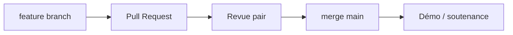

# Subdivision du travail — équipe CIA

Document pour le trophée `proj_subdivision`.

## Membres

| Membre | Rôle principal | Domaines |
|--------|----------------|----------|
| **Meriem ZAHZOUH** | Lead infra S2, doc, démo | Proxmox S2, pfSense S2, bastion, site interne, README, scénarios démo |
| **Kévin SEMERCIYAN** | Services & IaC | InfraService, Vault, Ansible, Terraform, Wazuh, NetBox, gantt, status |
| **Équipe** | Revue & soutenance | Tests croisés, captures, présentation orale |

## Répartition par domaine

| Domaine | Responsable | Livrables dépôt |
|---------|-------------|-----------------|
| Architecture & diagrammes | Meriem + Kévin | `architecture.md`, `architecture-diagram.*` |
| Réseau S2 (pfSense, NAT, VPN) | Meriem | `network-site2.md`, `configs/pfsense/site2-*` |
| Réseau S1 (pfSense, AD) | Kévin | `network-site1.md`, `configs/pfsense/site1-*` |
| VPN IPsec | Kévin | Config pfSense, `demo-scenarios.md` § A |
| Bastion & site interne | Meriem | `apps/internal-site/`, rôle Ansible `bastion` |
| NetBox IPAM | Kévin | `configs/netbox/`, playbooks sync |
| Vault & secrets | Kévin | `secrets-and-access.md`, intégration Ansible |
| Wazuh / observabilité | Kévin | `observability-guide.md`, agents |
| Ansible | Kévin | `iac/ansible/` |
| Terraform | Kévin | `iac/terraform/` |
| Kill switch & DRP | Meriem + Kévin | `drp-runbook.md`, `scripts/kill-switch-s2.sh` |
| Documentation générale | Meriem | `README.md`, `trophees-validation.md`, checklist |
| Planification | Kévin | `gantt.md`, `status-2026-06-23.md` |
| Présentation soutenance | Équipe | `presentation-guide.md`, slides (hors repo) |

## Jalons par membre

### Meriem — livrés

- [x] Restructuration dépôt CIA (Proxmox)
- [x] Architecture S2 opérationnelle (VMs 100–102)
- [x] Scénarios démo VPN, bastion, pare-feu, DNS
- [x] Site interne nginx
- [x] Grille Excel évaluation + preuves SSH/site interne
- [x] Harmonisation documentation

### Kévin — livrés

- [x] Status avancement 23/06 (`status-2026-06-23.md`)
- [x] Gantt F0–F11 aligné grille évaluation
- [x] InfraService : NetBox, Vault, Wazuh, Ansible, Terraform
- [x] Intégration Ansible ↔ Vault AppRole
- [x] Terraform init/validate/plan Proxmox

### Backlog partagé (reste)

| Tâche | Assigné | Priorité |
|-------|---------|----------|
| Template Cloud-Init + `terraform apply` | Kévin | 🔴 |
| Dashboards Wazuh + captures | Kévin | 🟡 |
| Kill switch test chronométré | Meriem | 🟡 |
| HTTPS / PKI / LDAPS | Kévin | 🟡 |
| Slides soutenance | Équipe | 🔴 |
| Captures pfSense + Wazuh + NetBox | Équipe | 🔴 |

## Communication

| Canal | Usage |
|-------|-------|
| GitHub (`main`, `feature/*`) | Code, docs, revues |
| PR + description tests | Validation avant merge |
| Coffre partagé (Bitwarden…) | Secrets, tokens, PSK VPN |

## Workflow collaboratif

Voir [`git-workflow.md`](./git-workflow.md).

## Références

- [`gantt.md`](./gantt.md) — planning détaillé
- [`status-2026-06-23.md`](./status-2026-06-23.md) — état par composant
- [`trophees-validation.md`](./trophees-validation.md) — 29 trophées
